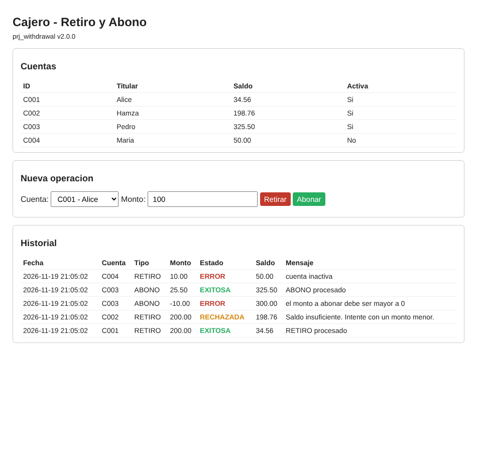

# DSL - Tarea refactorizando (prj_withdrawal)

Cajero web en Go: retiro, abono y registro de transacciones.
Trabajo del curso DSL (UNI - FIIS), hecho con BDD (Gherkin) y TDD (go test).



## Historias de usuario

- US-01, US-02, US-03: retiro de efectivo (exito, saldo insuficiente, monto invalido)
- US-01b: abono en efectivo
- US-04: integridad de la transaccion y log en JSON

## Estructura

```
cmd/web       aplicacion web
cmd/cli       version de consola
cuenta        logica (Cuenta, Banco, log) y pruebas
features      archivos .feature
data          cuentas.json
logs          transacciones.json
```

## Como ejecutar

Se necesita Go 1.22 o superior.

```
git clone https://github.com/Gabo31029/DSL-Tarea-refactorizando.git
cd DSL-Tarea-refactorizando
go test ./... -v
go run ./cmd/web
```

y abrir http://localhost:8080

Version de consola: `go run ./cmd/cli -menu`

## API

- `GET /api/cuentas`
- `GET /api/transacciones`
- `POST /api/transaccion` con `{"cuenta_id":"C001","tipo":"RETIRO","monto":200}`
  - 200 si es EXITOSA, 409 si es RECHAZADA, 422 si es ERROR

## Informe

El informe (formato IEEE) esta en [docs/Informe_Entrega3_AppWeb_IEEE.pdf](docs/Informe_Entrega3_AppWeb_IEEE.pdf).

Autor: Gabriel Chupa Ballesteros (20240160G)
